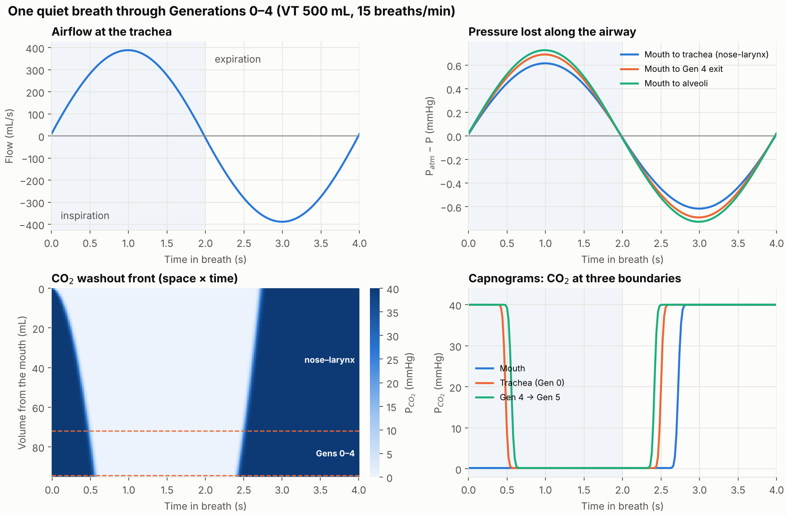
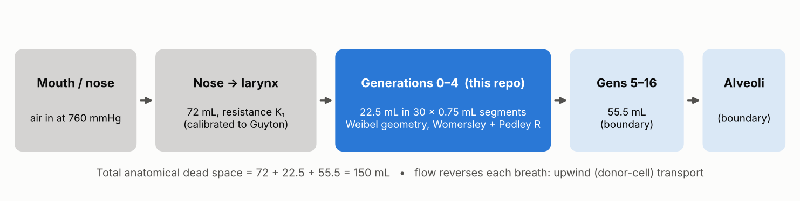
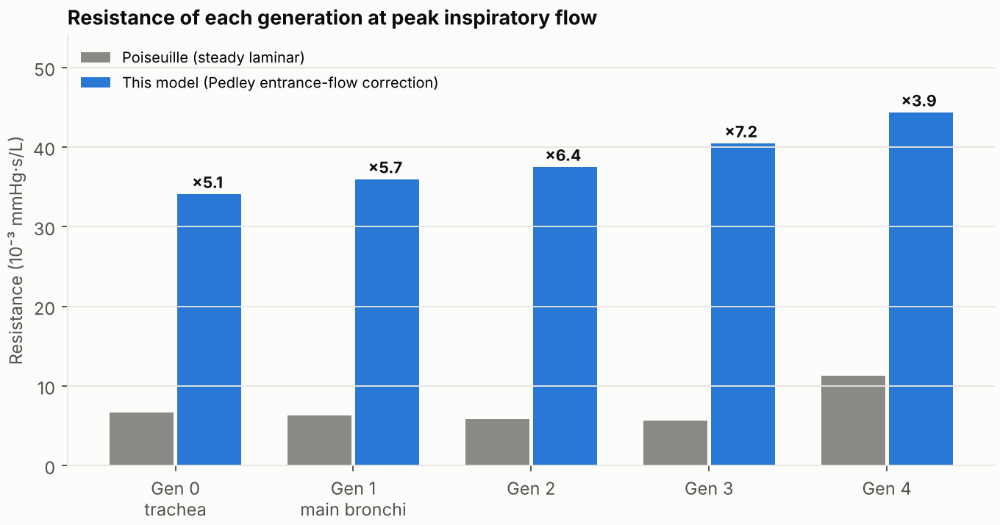
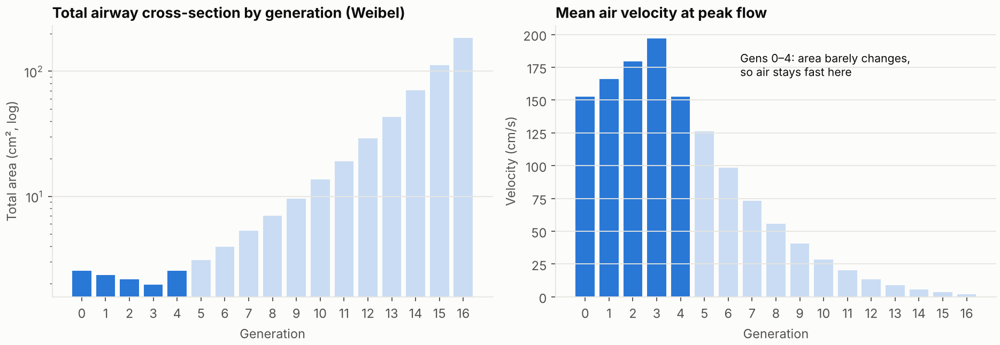

# Upper-Airway Flow & Dead-Space Transport Model (Generations 0–4)

[](https://github.com/ezzycool-dev/computation-lung-model/actions/workflows/tests.yml)


A physics-based model of how air and gas move through the **trachea and the first four
generations of bronchi** during a quiet breath. It computes the airflow, the pressure at
every branch point, and how fresh air and CO₂-rich "stale" air travel back and forth
through the anatomical dead space.

Built as my module of a multi-compartment lung model for an ECMO-focused bioengineering
project (Rice University, BIOE 252). This repository contains only the part I designed and
coded: **Generations 0–4 plus the nose-to-larynx inlet**. Everything below Generation 4 is
reduced to a simple boundary condition.



## Highlights

- **Anatomy, not a lumped constant.** The airway tree is built from Weibel's measured
  geometry: 2ᵏ tubes per generation, with real diameters and lengths. Volume, area,
  resistance and inertance follow from that table, so narrowing one generation, as in
  asthma, changes the whole model.
- **Physically correct resistance.** Plain Poiseuille law underestimates large-airway
  resistance. Each generation uses the larger of the Womersley (oscillatory) and Pedley
  (entrance-flow) corrections. At peak flow this raises resistance **4–7×** in Gens 0–4.
- **A moving gas front instead of instant mixing.** The 22.5 mL of Gens 0–4 is split into
  **30 well-mixed segments** with direction-switching (upwind) transport. Stale air reaches
  the alveoli first on inhalation, and dead-space gas leaves first on exhalation, the effect
  Fowler's method is based on.
- **Calibrated, not tuned.** The nose-to-larynx resistance is the only fitted number. It is
  set so the whole airway reproduces Guyton's benchmark: about 1 cmH₂O moves 0.5 L in 2 s.
- **Checked against 13 physics tests on every push** (GitHub Actions + GNU Octave):
  - exact mass conservation across every boundary
  - the Fick principle
  - Bohr dead space recovered from the simulated capnogram (150.0 mL vs. 150 mL in Guyton)
  - grid convergence and periodic steady state

## Results (quiet breathing, VT = 500 mL, 15 breaths/min)

| Quantity | Model | Reference |
| --- | --- | --- |
| Peak inspiratory flow | 388 mL/s | — |
| Alveolar pressure at peak inspiration | −0.73 mmHg | ≈ −1 cmH₂O = −0.74 mmHg (Guyton) |
| Pleural pressure swing | −3.68 → −6.01 mmHg | −5 → −7.5 cmH₂O = −3.7 → −5.5 mmHg (Guyton) |
| Resistance, Gens 0–4 (at peak flow) | 0.192 mmHg·s/L | ≈ 2× Gens 5–16 (0.095) |
| Max Reynolds number (trachea) | 1625 | < 2000, laminar at rest (Feher) |
| Dead space: nose–larynx / Gens 0–4 / Gens 5–16 | 72 / 22.5 / 55.5 mL | 150 mL total (Guyton) |
| **Bohr dead space from the mouth capnogram** | **150.0 mL** | 150 mL (Guyton) |
| Fresh air reaches the Gen 4 exit | 0.56 s into inspiration | — |
| Net O₂ / CO₂ per breath (same at every boundary) | 22.76 / 18.33 mL | Fick: 22.75 / 18.33 mL |

Gas volumes crossing each boundary in one breath (`results/boundary_gas.csv`):

| Boundary | O₂ in | O₂ out | CO₂ in | CO₂ out |
| --- | ---: | ---: | ---: | ---: |
| Mouth | 98.3 | 75.5 | 0.1 | 18.5 |
| Trachea (Gen 0 entry) | 93.6 | 70.9 | 3.9 | 22.2 |
| Gen 4 → Gen 5 | 92.2 | 69.4 | 5.1 | 23.4 |

At every boundary, inspired minus expired gives the same net O₂ (22.76 mL) and CO₂
(18.33 mL). Nothing is created or lost inside the airways, as there are no alveoli to exchange gas.

## How it works



**1. Geometry.** Generation $k$ has $n_k = 2^k$ identical tubes of diameter $d_k$ and length $L_k$:

$$A_k = n_k \frac{\pi d_k^2}{4}, \qquad V_k = A_k L_k$$

**2. Resistance and inertance per generation.** Poiseuille resistance is scaled by the
larger of Womersley's oscillatory-flow factor $\Phi_W$ and Pedley's entrance-flow factor $\Phi_P$:

$$R_k = \frac{8\mu L_k}{\pi r_k^4\, n_k}\,\max\left(\Phi_W,\ \Phi_P,\ 1\right),\qquad
\Phi_P = 0.327\sqrt{\mathrm{Re}_k \frac{d_k}{L_k}},\qquad \mathrm{Re}_k = \frac{\rho\, (Q/A_k)\, d_k}{\mu}$$

The inertance $L_k$ comes from Womersley's Bessel-function solution for oscillating flow in a rigid tube.

**3. Coupled breathing.** The airway and a compliant lung are solved together (stiff ODEs, `ode15s`):

$$\frac{dV_A}{dt} = Q,\qquad L\frac{dQ}{dt} = P_{atm} - P_{alv}(V_A, t) - \Delta P_{nose}(Q) - \sum_k R_k(Q)\,Q$$

The breathing-muscle drive is rescaled until the tidal volume is exactly 500 mL.

**4. Pressure profile.** The momentum balance on each generation gives the pressure at every branch point:

$$P_k - P_{k+1} = R_k(Q)\,Q + L_k \frac{dQ}{dt}$$

**5. Gas transport.** Each gas $s \in \{O_2, CO_2, N_2, H_2O\}$ is tracked in every segment $j$.
Gas flows in from the upstream neighbour, whichever direction the air is moving:

$$V_j\frac{dC_{s,j}}{dt} = |Q|\left(C_{s,\text{upstream}} - C_{s,j}\right)$$

Summed over Gens 0–4, this is the compartment balance
$\dfrac{dN_s}{dt} = Q_{in} C_{s,in} - Q_{out} C_{s,out}$. There is no source term because
the conducting airways have no alveoli.

The full derivation, every assumption and the source of every constant are in
[`docs/METHODS.md`](docs/METHODS.md).





## Validation

`tests/run_tests.m` runs these checks on every push:

| # | Check | Result |
| --: | --- | --- |
| 1 | Tidal volume held at 500 mL | 499.97 mL |
| 2 | Alveolar pressure at peak inspiration ≈ −1 cmH₂O (Guyton) | −0.727 mmHg |
| 3 | Pressure path mouth → Gen 4 → alveoli closes | 1e-13 mmHg |
| 4 | Gens 0–4 carry ≈ 2× the resistance of Gens 5–16 | 2.03× |
| 5 | Laminar at rest: Re < 2000 everywhere (Feher) | max 1625 |
| 6 | Mass conservation: same net O₂/CO₂ at every boundary | exact to 0.01 mL |
| 7 | Fick principle: net gas = alveolar ventilation × partial-pressure gap | < 0.1 % |
| 8 | Bohr dead space at the mouth = 150 mL | 150.0 mL |
| 9 | Bohr dead space at the trachea = intrathoracic volume | 78.0 mL |
| 10 | Ideal gas law holds in every segment | 5e-3 mol/m³ |
| 11 | Periodic steady state (flow and gas) | 5e-5 L |
| 12 | Grid convergence: doubling the segments moves dead space < 1 mL | 0.00 mL |
| 13 | Regression against an earlier version | within 1–2 % |

## Quick start

**MATLAB** (R2019b+) or **GNU Octave** (8+), from the repository root:

```matlab
run_upper_airway            % solve, print a summary, write results/*.csv
addpath tests; run_tests    % run the 13 checks
```

Regenerate the figures (Python 3):

```bash
pip install numpy pandas matplotlib
python scripts/make_figures.py
```

To try a scenario, change a parameter and re-run. For example, to narrow the main bronchi by 20 %:

```matlab
p = upper_airway_params();
p.weibel_d_cm(2) = 0.8 * p.weibel_d_cm(2);
out = upper_airway_model(p);
```

## Repository layout

```text
run_upper_airway.m           entry point
src/
  upper_airway_params.m      every constant, with unit and source
  upper_airway_model.m       solver: geometry -> mechanics -> pressures -> gas transport
  geometry/                  Weibel geometry for Gens 0-4
  mechanics/                 Womersley/Pedley resistance, inertance, coupled breathing,
                             nose-larynx calibration, pressure profile
  transport/                 segment-chain gas transport, ideal-gas check
  boundary/                  simplified Gens 5-16 + lung (boundary condition only)
  io/                        CSV export
tests/run_tests.m            13 physics and numerics checks
scripts/make_figures.py      README figures from results/*.csv
results/                     model output (CSV)
docs/                        METHODS.md, REFERENCES.md, figures
```

## Assumptions and limitations

- **Rigid, symmetric airways.** Every tube in a generation is identical (Weibel's
  symmetric model), and airway volume does not change with lung volume.
- **Quiet breathing only.** Flow is laminar (Re < 2000). Exercise or forced expiration
  would need the turbulent $K_2 Q^2$ term and airway compression.
- **Well-mixed segments.** Molecular diffusion and heartbeat-driven mixing are ignored.
- **Simplified surroundings.** Below Gen 4 the airway sees a lumped Poiseuille resistance
  and a linear-compliance lung with fixed alveolar gas. In the full team model these are
  separate, detailed modules built by teammates.

## Context

This module was one compartment of a team-built model linking airway mechanics, dead-space
transport and alveolar gas exchange, aimed at understanding oxygenation in patients on ECMO.
My scope was the upper airway (Gens 0–4), its interface with the nose and larynx, and the
dead-space handoff to the lower airways. The other compartments are not included here.

## References

Key sources: Hall, *Guyton and Hall Textbook of Medical Physiology* (12th ed.); Feher,
*Quantitative Human Physiology* (2nd ed.); Weibel model A as tabulated in Murayama et al.,
*J Drug Deliv* 2019; Pedley, Schroter & Sudlow 1970; Womersley 1955; Robertson,
*Eur Respir J* 2015; Brewer & Orr 2007. Full list: [`docs/REFERENCES.md`](docs/REFERENCES.md).

## License

MIT. See [`LICENSE`](LICENSE).
